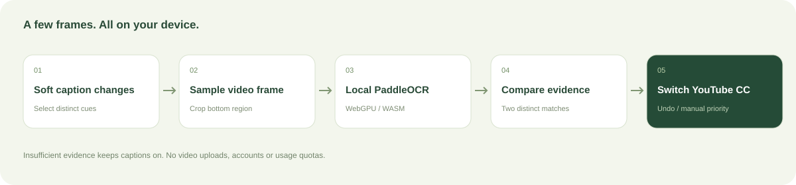

<p align="center"></p>

<p align="center"><strong>English</strong> · <a href="README.zh-CN.md">简体中文</a></p>

# YouTube Subtitle Auto Switcher

A local-first Chrome extension that enables available YouTube captions and switches off duplicate captions when the video already contains the same burned-in text.

**No accounts. No subscriptions. No usage quotas. Video frames stay on your device.**

The extension is an independent implementation using the open-source PaddleOCR SDK. It does not reuse subtitle.im's extension code, branding, account services or paid entitlement mechanisms.

## What it does

- Automatically enables existing YouTube captions.
- Samples a few distinct caption moments and recognizes burned-in text locally.
- Requires two distinct matching caption texts before hiding duplicate captions.
- Lets you restore captions immediately; manual CC changes take priority for the current viewing.
- Supports video and channel rules, with video rules taking precedence.
- Remembers confirmed duplicate closures for 30 days, with a clear-cache action.
- Includes common OCR models; downloads additional language models from PaddleOCR's official host on demand.
- Includes local diagnostics and a local-image OCR check. Neither sends images to a server.

The settings interface currently uses Simplified Chinese. This documentation is available in English and Chinese.

## Preview


The settings screenshot shows the actual 0.1.0 extension page; 0.2.0 improves contrast and keyboard behavior without changing the basic layout. The player screenshot below uses an original synthetic video fixture to demonstrate the controls; it is not a screenshot of a third-party YouTube video.


## Install from source

Requirements: **Node.js 22+**, npm, and desktop Chrome 116+ (or a compatible Chromium browser). Use a current browser for the best WASM/WebGPU compatibility.

```bash
git clone https://github.com/nickcxm/youtube-subtitle-auto-switcher.git
cd youtube-subtitle-auto-switcher
npm ci
npm run models
npm run build
```

1. Open `chrome://extensions`.
2. Enable **Developer mode**.
3. Click **Load unpacked** and choose this project's **`dist`** directory.
4. Open or refresh a YouTube watch page.
5. Open the extension's settings from the toolbar, or use **LC** in the player controls. A settings tab opened from LC stays bound to that YouTube tab; unrelated settings tabs disable video-specific actions.

`npm run models` downloads official model archives into `public/models`. Models, dependencies and generated bundles are intentionally excluded from Git. No API keys or environment configuration are required.

To bundle every supported language model for offline use:

```bash
npm run models -- --all
npm run build
```

To create a distributable ZIP after preparing models:

```bash
npm run package
```

The ZIP contains the loadable extension files. Unzip it before using **Load unpacked**. This repository does not claim Chrome Web Store publication.

## How it works



The content script reads visible soft-caption text and captures the corresponding frame directly from the video element. YouTube's HTML caption overlay is not drawn into that video frame. The extension crops and scales the bottom of the frame, runs PaddleOCR in a dedicated Worker managed by a lightweight hidden extension document, and compares the recognized text with the captured soft-caption text.

Matching normalizes case, punctuation and Chinese traditional/simplified forms, tolerates some OCR errors, and accumulates evidence across different texts. The default budget is six sampled caption moments per detection round. Paused videos, advertisements and hidden tabs do not initiate automatic OCR. Caption changes trigger sampling instead of recurring page polling. Frame capture uses video-frame callbacks and asynchronous JPEG encoding. Invalidated rounds cancel their queued or running task, and stale results are discarded.

Priority:

```text
Manual CC for this viewing → video rule → channel rule → global preferences
```

Different-language detection uses conservative script-family evidence, not machine translation. English and Spanish, for example, share the Latin alphabet and are not distinguished using this heuristic. Keep-both is the default. A changing, consistently positioned text region is required before the cross-script policy is applied.

## Models and performance

| Profile | Coverage | Default distribution |
| --- | --- | --- |
| general | Chinese, English, Japanese | Bundled |
| latin | Latin-script languages | Bundled |
| devanagari | Hindi and related scripts | Bundled |
| arabic | Arabic-script languages | Bundled |
| korean | Korean | Download on demand |
| cyrillic | Russian and related scripts | Download on demand |
| thai / greek / tamil / telugu | Corresponding scripts | Download on demand |

Model selection follows available audio/caption language hints. If the burned-in language differs, select the appropriate model manually. The extension does not run all models at once. A single OCR engine is reused and model jobs are serialized across tabs. Queue waiting, model downloads and inference have separate deadlines; one task timing out does not close the shared coordinator. Each client receives a task ID and queries results through short messages, so service-worker restarts do not hold a long-running response channel. After five idle minutes the inference Worker is terminated; the small coordinator stays available for new tasks.

WASM is the default for compatibility and predictable startup. Optional automatic mode tries WebGPU when available and falls back to WASM. **WASM compatibility mode** is available in settings. WASM uses one thread to avoid threaded-runtime requirements and excessive CPU use. First initialization costs more than subsequent recognition.

## Privacy

- No login, license checks, payment integration, analytics or telemetry.
- No video frames or caption texts are uploaded.
- Network access by the extension is limited to official model downloads when a non-bundled model is needed.
- Preferences, video/channel rules, confirmed results and diagnostic events stay in extension-local storage.
- Diagnostic logs are capped at 200 events and exclude images, recognized text and credentials. Export is user initiated.
- The extension requests `storage`, `offscreen`, `activeTab`, and `alarms`, plus host access to `www.youtube.com` and the official PaddleOCR model host.

Clearing downloaded models does not remove bundled models. Clearing confirmed results forces future detections to gather fresh evidence. Restoring captions removes the matching confirmed-closure record.

## Development and validation

```bash
npm run typecheck
npm test
npm run build
```

The reusable checks also cover isolated queue timeouts, cancellation, task ownership and target-tab URL validation. They cover text normalization, OCR-error tolerance, distinct-text evidence, low-confidence rejection, static-watermark rejection, cross-script evidence, rule precedence, model selection and manifest permissions. Browser verification details are recorded in [docs/VALIDATION.md](docs/VALIDATION.md).

```text
src/
  background.ts   Message routing, offscreen lifecycle and local storage
  bridge.ts       Minimal YouTube metadata bridge; no fetch/XHR interception
  content.ts      Frame sampling, player controls and viewing state
  decision.ts     Text normalization and evidence accumulation
  offscreen.ts    Task coordinator and model cache
  ocr-worker.ts   Cancellable SDK inference outside the page thread
  jobs.ts         Per-task queue state, ownership and expiry
  images.ts       Asynchronous JSON-compatible image encoding
  popup.ts        Preferences, model management and local diagnostics
scripts/
  models.mjs      Official model downloads
  build.mjs       Extension bundling and runtime assets
  opencv-csp.mjs  Pinned OpenCV wrapper adaptation for Manifest V3
  test.mjs        Reusable algorithm and permission checks
```

The pinned OpenCV dependency uses four dynamic JavaScript binding wrappers. The build replaces those wrappers with equivalent closures, with strict matching checks. It does **not** relax extension CSP or enable JavaScript `unsafe-eval`. See [third-party notices](THIRD_PARTY_NOTICES.md).

## Limitations

- Supports desktop `www.youtube.com/watch` pages. Shorts, mobile apps and other video sites are outside the current scope.
- Manages existing captions; does not generate, translate, download or erase subtitles from the video.
- Clear subtitles near the bottom work best. Unusual placement, stylized lettering, low resolution and timing differences can prevent detection.
- Low-confidence results keep captions enabled. Incorrect closures can be undone.
- YouTube DOM and player metadata can change. Compatibility requires continued testing.
- Local storage has browser-imposed capacity limits; “unlimited” means no product usage quota, not unlimited hardware resources.

## License

Original project code and original documentation artwork are licensed under [MIT](LICENSE). Third-party code and model assets retain their respective licenses. See [THIRD_PARTY_NOTICES.md](THIRD_PARTY_NOTICES.md).
