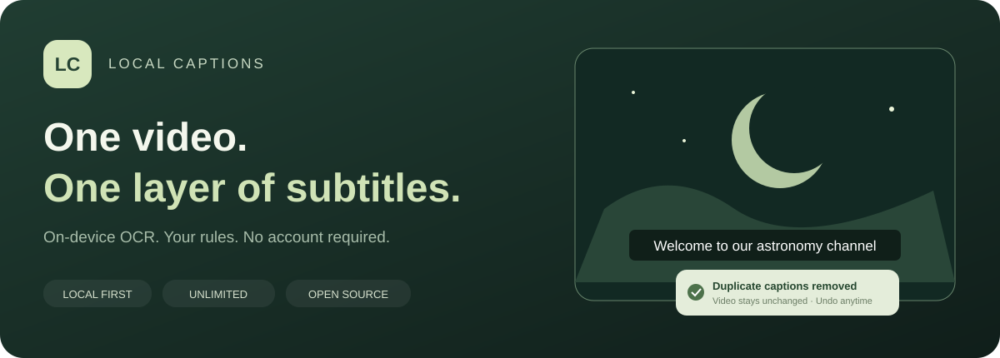
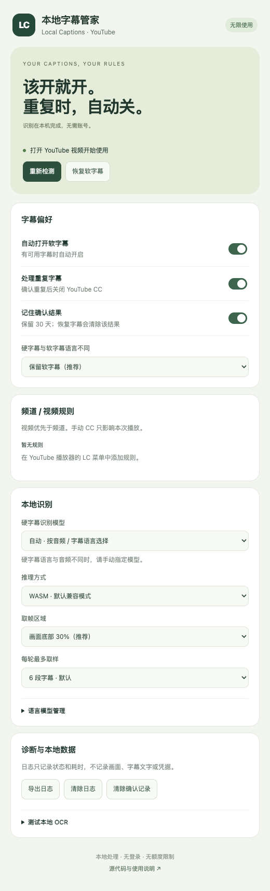
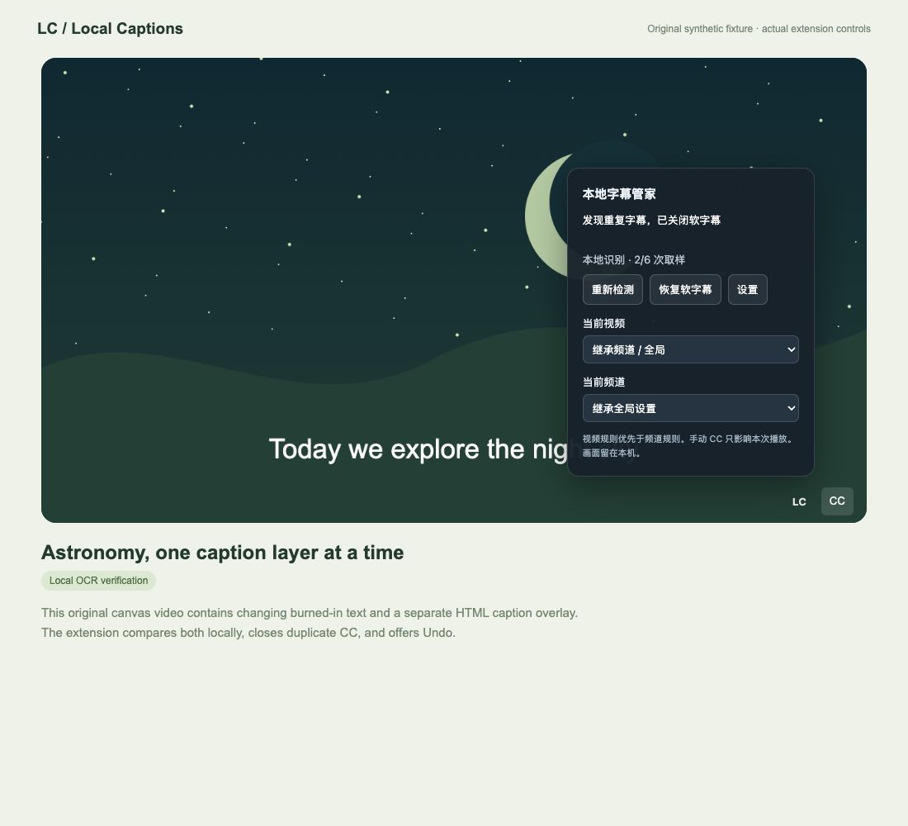
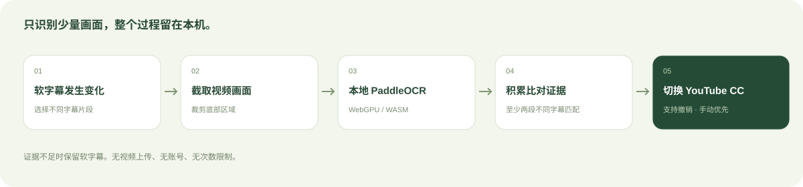

<p align="center"></p>

<p align="center"><a href="README.md">English</a> · <strong>简体中文</strong></p>

# YouTube 字幕自动切换 · 本地字幕管家

一个在本机运行的 Chrome 扩展：自动开启 YouTube 已有软字幕；视频画面已经包含相同硬字幕时，经过多次验证后关闭重复的软字幕。

**无需账号，无订阅，无使用次数限制。视频画面留在本机。**

本项目使用 PaddleOCR 官方开源 SDK 独立实现，没有复用 subtitle.im 的扩展代码、品牌、账号服务或付费权益机制。

## 功能

- 自动开启 YouTube 可用软字幕。
- 对少量不同字幕片段取帧，在本机识别画面文字。
- 至少两段不同软字幕匹配，才关闭重复字幕。
- 支持恢复和撤销；手动操作 CC 后，本次播放由你控制。
- 支持全局、频道和单个视频规则，视频规则优先。
- 确认结果记忆 30 天，可随时清除。
- 常用 OCR 模型内置，其他语言模型按需从官方源下载。
- 支持本地日志导出和本地图片 OCR 测试，不上传图片。

设置界面目前使用简体中文。README 提供中英文切换。

## 界面预览



上图是实际扩展设置页面。下面的播放器截图使用本项目生成的模拟视频演示控件，并非第三方 YouTube 视频截图。



## 安装

需要 **Node.js 22+**、npm，以及桌面 Chrome 116+ 或兼容的 Chromium 浏览器。建议使用较新的浏览器以获得更好的 WASM / WebGPU 兼容性。

```bash
git clone https://github.com/nickcxm/youtube-subtitle-auto-switcher.git
cd youtube-subtitle-auto-switcher
npm ci
npm run models
npm run build
```

1. 打开 `chrome://extensions`。
2. 开启右上角的「开发者模式」。
3. 点击「加载已解压的扩展程序」，选择项目中的 **`dist`** 目录。
4. 打开或刷新 YouTube 视频页面。
5. 在工具栏打开扩展设置，或点击播放器控制栏中的 **LC**。

`npm run models` 将官方模型下载到 `public/models`。模型、依赖和构建产物不提交到 Git；不需要任何 API Key 或环境变量配置。

希望所有支持的模型都随插件打包、离线使用时：

```bash
npm run models -- --all
npm run build
```

准备好模型后生成可分发的压缩包：

```bash
npm run package
```

压缩包包含可加载的扩展文件；使用「加载已解压的扩展程序」前先解压。本项目暂未宣称已上架 Chrome 应用商店。

## 实现原理



内容脚本读取当前显示的软字幕文字，同时从 `<video>` 截取对应画面。YouTube 使用 HTML 叠加的软字幕不会被画进视频帧，因此可以将画面硬字幕与软字幕分开比对。

扩展裁剪并缩放视频底部，在隐藏的扩展页面中运行 PaddleOCR。比对时统一大小写、标点和中文繁简，容忍部分 OCR 错字，并在多个不同字幕片段中积累证据。

默认每轮最多取样六段字幕。暂停、广告和后台标签页不发起自动 OCR；已失效检测轮次的结果会丢弃。

规则优先级：

```text
本次播放的手动 CC → 视频规则 → 频道规则 → 全局偏好
```

不同语言处理使用保守的文字体系判断，不使用机器翻译。例如英文和西班牙文都使用拉丁字母，无法仅凭此方法可靠区分。默认保留两层字幕；跨文字体系处理需要多段文字变化且位置稳定的证据。

## 模型与性能

| 模型 | 主要覆盖范围 | 默认分发方式 |
| --- | --- | --- |
| general | 中文、英文、日文 | 内置 |
| latin | 拉丁字母语言 | 内置 |
| devanagari | 印地语等天城文 | 内置 |
| arabic | 阿拉伯文字 | 内置 |
| korean | 韩语 | 按需下载 |
| cyrillic | 俄语等西里尔文字 | 按需下载 |
| thai / greek / tamil / telugu | 对应文字体系 | 按需下载 |

自动模式参考音频和字幕语言选择模型。如果硬字幕与音频语言不同，请手动选择模型。不会同时运行所有模型；OCR 引擎复用，多个标签页的识别请求串行执行。

默认使用 WASM，兼顾兼容性和初始化开销。可选的自动推理模式尝试可用的 WebGPU，并回退 WASM。遇到兼容问题可在设置中选择「WASM 兼容模式」。WASM 使用单线程，降低环境要求并控制 CPU 占用。第一次初始化通常比后续识别更慢。

## 隐私与权限

- 没有登录、授权校验、支付、统计或遥测。
- 不上传视频帧和字幕文字。
- 扩展的联网行为仅用于从官方源下载未内置的语言模型。
- 偏好、规则、确认结果和诊断事件保存在扩展本地存储。
- 日志最多 200 条，不包含画面、识别文字或凭据；导出由用户主动操作。
- 权限为 `storage`、`offscreen`、`activeTab`，以及 `www.youtube.com` 和官方 PaddleOCR 模型域名的访问权限。

清除下载模型不删除内置模型。清除确认记录后，后续观看会重新获取检测证据。恢复软字幕会删除对应的确认关闭记录。

## 开发与验证

```bash
npm run typecheck
npm test
npm run build
```

保留的回归检查覆盖文字归一化、OCR 错字容忍、独立字幕证据、低置信度拒绝、静态水印拒绝、跨文字体系证据、规则优先级、模型映射及扩展权限。浏览器实测记录见 [docs/VALIDATION.md](docs/VALIDATION.md)。

主要模块：

| 文件 | 职责 |
| --- | --- |
| `src/background.ts` | 消息路由、隐藏页面生命周期、本地存储 |
| `src/bridge.ts` | YouTube 元数据桥接，不拦截 fetch / XHR |
| `src/content.ts` | 取帧、播放器入口、观看状态 |
| `src/decision.ts` | 文字归一化与证据积累 |
| `src/offscreen.ts` | 本地 OCR 和模型缓存 |
| `src/popup.ts` | 偏好、模型管理与诊断 |
| `scripts/opencv-csp.mjs` | 针对锁定版 OpenCV 的 MV3 兼容处理 |

OpenCV 依赖内的四个动态 JavaScript 绑定包装函数在构建时替换为等价闭包，并严格检查匹配结果。没有放宽扩展 CSP，也没有启用 JavaScript `unsafe-eval`。详情见 [第三方声明](THIRD_PARTY_NOTICES.md)。

## 已知边界

- 支持桌面 `www.youtube.com/watch` 页面，暂不支持 Shorts、手机 App 和其他视频网站。
- 只管理已有字幕，不生成、翻译或下载字幕，也不擦除视频画面中的文字。
- 适合画面底部清晰的字幕。特殊位置、花字、低画质及字幕时间差会影响识别。
- 证据不足时保留字幕；误关可恢复。
- YouTube DOM 和播放器元数据可能变化，需要持续维护兼容性。
- 「无限使用」表示没有产品次数配额，浏览器存储和设备性能仍有实际上限。

## 许可证

本项目原创代码和原创文档插图使用 [MIT](LICENSE) 许可证。第三方代码和模型保留各自许可证，见 [THIRD_PARTY_NOTICES.md](THIRD_PARTY_NOTICES.md)。
